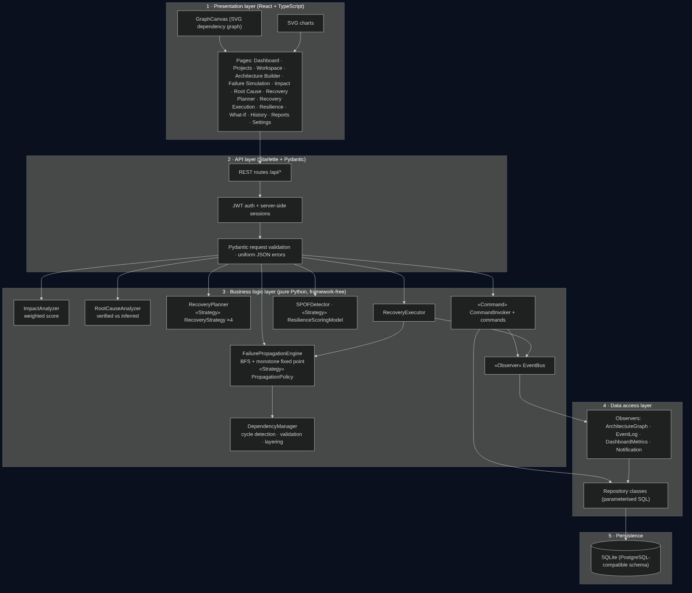
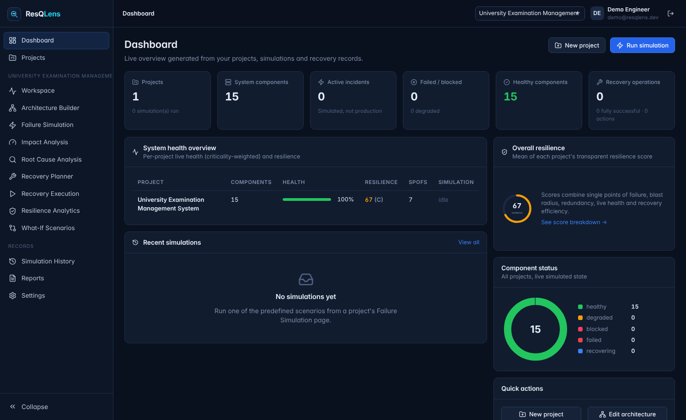
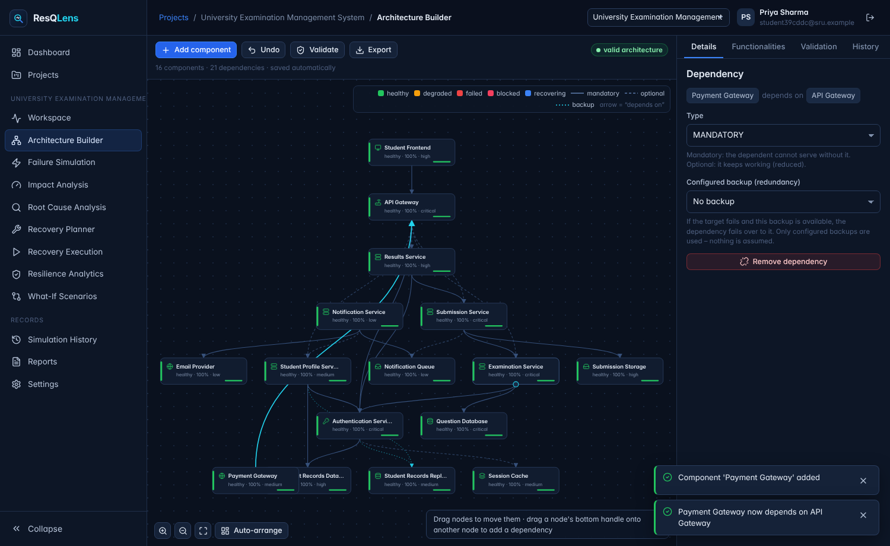
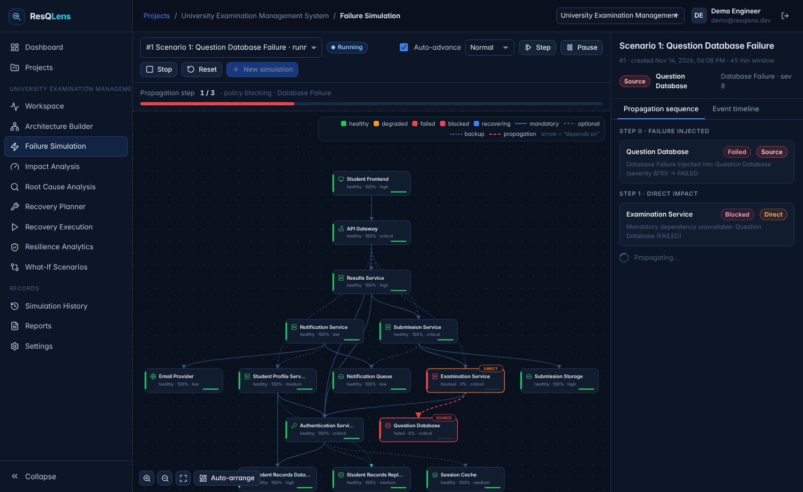
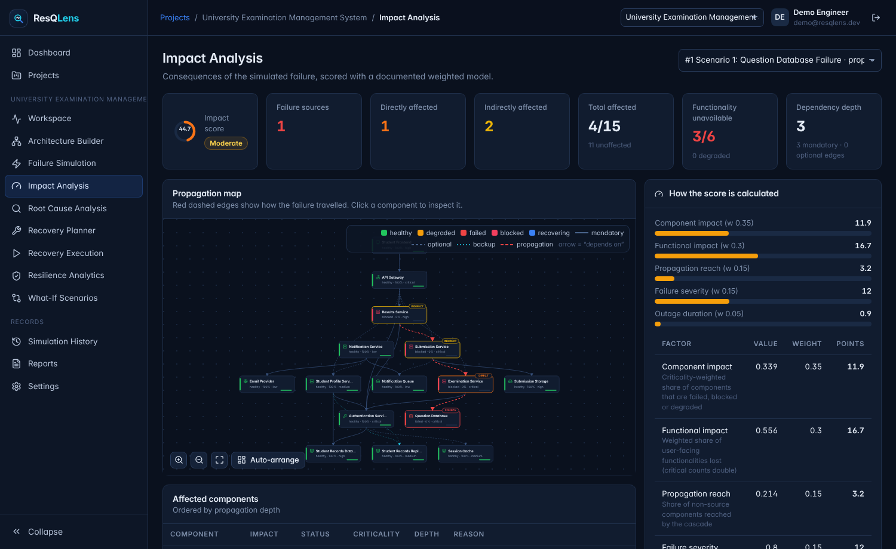
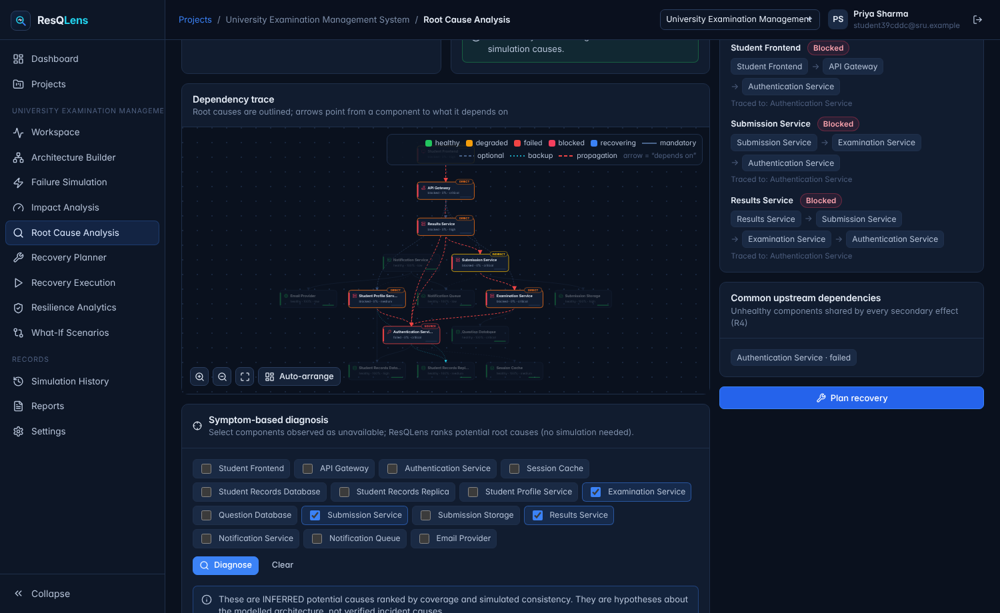
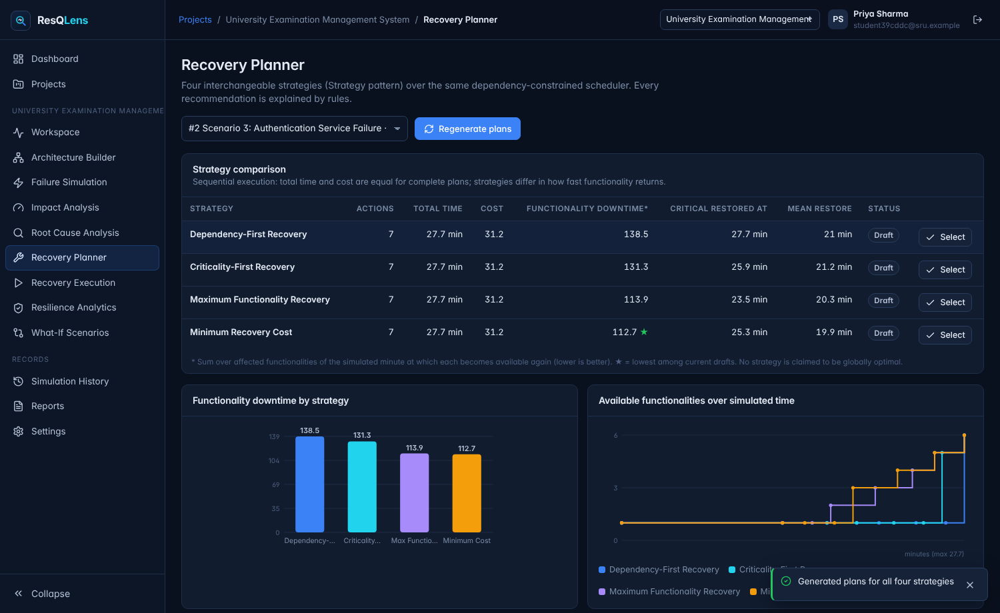
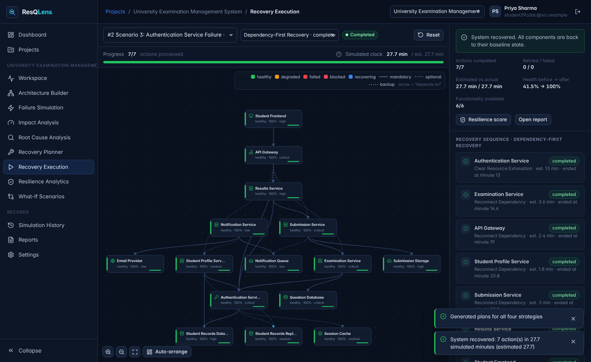
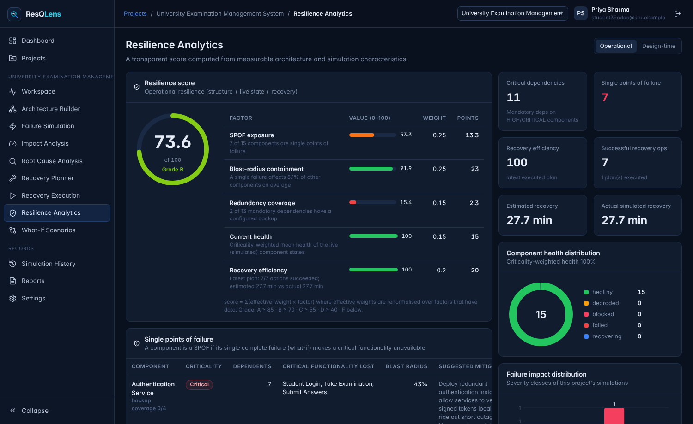

# ResQLens – Intelligent System Failure Diagnosis & Recovery Decision Support

ResQLens is a full-stack web application for modelling a software system's architecture, injecting simulated failures, watching them cascade through the dependency graph, explaining the impact and root cause, and planning and executing a recovery. All of this runs in an isolated, deterministic simulation.

> **Simulation only.** ResQLens never connects to or runs commands on real infrastructure. Every failure, status, score and recovery time is computed by documented, rule-based algorithms over *your modelled architecture*. No randomness, no machine learning and no AI-generated reasoning are used.



---

## Contents
1. [Features](#features)
2. [Technology stack](#technology-stack)
3. [Quick start](#quick-start)
4. [Demo walkthrough](#demo-walkthrough)
5. [Project structure](#project-structure)
6. [Configuration](#configuration)
7. [Tests](#tests)
8. [Documentation index](#documentation-index)
9. [Design decisions and limitations](#design-decisions-and-limitations)

---

## Features

| Module | What it does |
|---|---|
| **1 · Authentication & Dashboard** | Registration, login and logout with PBKDF2 password hashing, JWT and server-side sessions (logout really revokes). Every dashboard number is computed from stored data: projects, components, active incidents, failed and healthy components, recovery operations, resilience score, recent activity and recent simulations. |
| **2 · Architecture Builder** | Interactive SVG graph: add, edit and delete components (10 types); drag a node's handle to connect components; edit dependencies (mandatory or optional, plus a configured backup); zoom, pan, drag and auto-arrange (layered layout). It also manages functionalities, validates the architecture (cycles, duplicates, missing references, invalid backups), offers **undo** through the Command pattern, and supports JSON export and import. |
| **3 · Failure Simulation Engine** | 7 failure classes plus *multiple simultaneous failures*, severity 1–10, duration and description. Start, pause, resume, step, stop and reset. The cascade is revealed chronologically. There are two propagation policies (Blocking and Fail-fast) and three operating rules (Strict, Standard, Tolerant). Circular graphs cannot cause infinite traversal. |
| **4 · Impact Analyzer** | Counts direct, indirect and total affected components, lost functionality, affected critical components, dependency depth and every propagation path. A **documented weighted impact score** feeds the LOW / MODERATE / HIGH / CRITICAL classification. |
| **5 · Root Cause Analysis** | Keeps **VERIFIED** causes (the injected events) separate from **INFERRED** candidates, which are derived only from statuses and the graph. It traces secondary effects, finds common upstream dependencies, and offers a symptom-based diagnosis tool that ranks hypotheses and checks them against simulation. |
| **6 · Recovery Recommendation** | Four interchangeable strategies: Dependency-First, Criticality-First, Maximum Functionality and Minimum Cost. Each one is dependency-valid by construction. Every action comes with an explanation (*what / why / dependencies / if skipped / benefit / order rationale*). Strategies can be compared side by side, and the sequence can be re-ordered by hand with server-side validation. |
| **7 · Recovery Execution Simulator** | Start, pause, resume, step or run instantly. Each step validates dependency availability; failed actions are re-queued once. It records timestamps and the simulated clock, then produces a summary (health before and after, functionality restored) and a resilience snapshot. |
| **8 · Resilience Scorecard** | A transparent five-factor score with a full breakdown, single points of failure with mitigations, health and impact distributions, recovery efficiency, estimated vs actual recovery time, and score history. Two interchangeable scoring models are provided. |
| **9 · History & Reports** | Filter by project, severity, status and date; compare 2–6 simulations; open a professional 9-section report; export **PDF** (ReportLab) and **CSV** (pandas). |
| **Advanced** | SPOF detection, what-if scenario comparison (dry run), configured-redundancy analysis (backups are never assumed), interactive event timeline, and rule-based explainable recommendations. |

## Technology stack

| Layer | Used here | Notes |
|---|---|---|
| Frontend | **React 19 + TypeScript**, bundled with **esbuild** | Lucide icons via `react-icons/lu` |
| Graph visualisation | Custom SVG `GraphCanvas` | zoom, pan, drag, drag-to-connect, auto-layout, status colours, propagation highlighting |
| Charts | Custom SVG chart components | gauge, donut, bar and line charts |
| Styling | Hand-written CSS design system | dark navy and slate palette with cyan and blue accents |
| Backend | **Python 3.10+**, **Starlette** (the ASGI toolkit FastAPI is built on), **Pydantic v2**, **uvicorn** | |
| Data access | Repository classes over the DB-API with parameterised SQL | **MySQL 8** (PyMySQL) or SQLite |
| Graph processing | **NetworkX** | cycle detection, reachability, topological sort |
| Reports | **ReportLab** (PDF), **pandas** (CSV) | |
| Tests | **pytest**: unit tests + live-HTTP integration tests | |

**Substitutions from the suggested stack (explained):** the build environment had no network access, so only pre-installed packages could be used. FastAPI, SQLAlchemy, React Flow, Tailwind and Recharts were therefore replaced by functionally equivalent implementations:
- **Starlette + Pydantic** gives the same routing, validation and response behaviour as FastAPI, which is a layer on top of Starlette.
- A **repository layer with parameterised SQL** replaces the SQLAlchemy ORM. It gives the same SQL-injection protection and transaction handling, and the schema still maps 1:1 to PostgreSQL.
- A purpose-built **SVG graph editor** replaces React Flow.
- A **hand-written CSS design system** and **SVG charts** replace Tailwind and Recharts.

The architecture keeps business logic independent of these choices, so swapping any of them back in only touches the API or presentation layer.

## Quick start

### Windows + VS Code + MySQL (recommended)
Full guide: **[docs/SETUP_WINDOWS.md](docs/SETUP_WINDOWS.md)**.
1. Install Python 3.10+, Node.js LTS, Git, VS Code and MySQL Server + Workbench.
2. MySQL Workbench (as root): open and run `database\create_database.sql`, after choosing the `resqlens_app` password in it.
3. `setup.bat`: creates the venv, installs packages, creates `.env` and builds the UI. Then put the app user's password in `.env` → `DB_PASSWORD=`.
4. `start_resqlens.bat`: starts the backend and frontend and opens the browser.

| URL | |
|---|---|
| http://localhost:5173 | frontend dev server (live reload, `/api` proxied to :8000) |
| http://localhost:8000 | backend; also serves the production build of the UI |
| http://localhost:8000/docs | interactive API documentation (Swagger UI) |
| http://localhost:8000/api/health | health + database check |

Demo account (seeded on first start): **demo@resqlens.dev / Demo@2026**

### Zero-setup (SQLite)
Set `DB_ENGINE=sqlite` in `.env` to run without MySQL: the data goes to `backend/resqlens.db`. On macOS/Linux, `./run.sh` does this automatically.

### Frontend commands
```bash
cd frontend
npm install
npm run dev          # http://localhost:5173 with live reload
npm run build        # production bundle -> frontend/dist (served by the backend)
npm run typecheck    # TypeScript type-check
```

### Database
- Engines: **MySQL 8** (`DB_ENGINE=mysql`, PyMySQL driver) or SQLite.
- The schema (`backend/app/schema_mysql.sql` / `schema.sql`) is applied idempotently at startup. It never drops data.
- Connection check: `cd backend && python -m scripts.check_db`.
- Backup: `database\backup.bat`.

### Deployment
Docker image, Docker Compose (app + MySQL) and free-tier hosting options: **[deployment/DEPLOYMENT.md](deployment/DEPLOYMENT.md)**.

## Demo walkthrough
The seeded **University Examination Management System** has 15 components, 20 dependencies (13 mandatory, 7 optional, and 2 protected by a configured read replica), 6 functionalities (3 critical) and 4 predefined scenarios.

| Scenario | Injected failure | Resulting cascade (Blocking policy) |
|---|---|---|
| 1 · Question Database Failure | Database Failure, severity 8 | Question DB → Examination (direct) → Submission → Results (indirect). Impact 44.7, MODERATE. 3 of 6 functionalities lost. |
| 2 · API Gateway Failure | Complete Service Failure, severity 9 | Gateway → Student Frontend. 5 of 6 functionalities lost (notifications keep working). |
| 3 · Authentication Service Failure | Resource Exhaustion, severity 8 | Auth → Gateway, Exam, Results, Profile → Frontend, Submission. Impact 64.5, HIGH. The four strategies now produce different orders. |
| 4 · Storage outage + slow cache | Two simultaneous failures | Submission Storage (failed) and Session Cache (degraded). Auth stays healthy because the cache is optional. |

Suggested live demo:
1. **Failure Simulation**: load Scenario 1, keep *Step-by-step* mode, press **Start** and watch the cascade.
2. **Impact Analysis**: see the score breakdown, functionality loss and propagation paths.
3. **Root Cause**: Question Database is marked VERIFIED and the INFERRED analysis agrees. Then try the symptom diagnosis with Examination, Submission and Results.
4. **Recovery Planner**: generate all four plans, compare them, open the explanations, and re-order the steps by hand to see validation reject an invalid order.
5. **Recovery Execution**: run step by step. Save an invalid order with *Allow invalid* checked to watch the dependency check fail an action and retry it.
6. **Resilience**, **What-If** (compare Scenarios 1–3), **History** (compare and export CSV) and **Reports** (download the PDF).

## Project structure
```
resqlens/
├── backend/
│   ├── app/
│   │   ├── main.py              # ASGI app, CORS, static frontend, startup
│   │   ├── config.py            # environment-based settings
│   │   ├── database.py          # connection + transaction helper
│   │   ├── schema.sql           # 17 tables, FKs, constraints, indexes
│   │   ├── security.py          # PBKDF2 hashing, JWT
│   │   ├── repositories.py      # data-access layer (all SQL lives here)
│   │   ├── seed.py              # demo project + scenarios
│   │   ├── domain/              # enums, Component/Dependency/SystemArchitecture, FailureEvent hierarchy
│   │   ├── engine/              # dependency manager, propagation, impact, root cause,
│   │   │                        # recovery strategies, executor, resilience, event bus
│   │   ├── services/            # orchestration: commands, simulation, recovery, analytics, reports
│   │   └── api/                 # schemas (Pydantic), routing (auth/errors), routes
│   ├── scripts/check_db.py      # database connectivity check
│   ├── tests/                   # test_engine.py (unit), test_api.py (integration; SQLite or MySQL)
│   └── requirements.txt
├── database/                    # create_database.sql, schema_mysql.sql, backup.bat
├── deployment/                  # docker-compose.yml, DEPLOYMENT.md, env.production.example
├── vscode-config/               # VS Code settings, debug launch, tasks, extensions (setup.bat installs into .vscode)
├── tools/                       # inspect_environment.ps1, verify_resqlens.ps1 (write reports to logs/)
├── setup.bat · start_resqlens.bat · start_backend.bat · start_frontend.bat
├── inspect_environment.bat · verify_resqlens.bat
├── Dockerfile · .env.example · resqlens.http
├── frontend/
│   ├── src/
│   │   ├── main.tsx             # router + providers
│   │   ├── styles.css           # design system
│   │   ├── lib/                 # api client, router, auth, toasts/confirm, hooks, layout algorithm
│   │   ├── components/          # Layout, GraphCanvas, charts, UI primitives, SimSelector
│   │   └── pages/               # 15 pages
│   ├── dist/                    # pre-built bundle
│   └── build.mjs
├── docs/                        # architecture, algorithms, patterns, API, database + diagrams
└── README.md
```

## Configuration
`.env` in the project root (template: [`.env.example`](.env.example); never committed):

| Variable | Default | Purpose |
|---|---|---|
| `APP_ENV` | `development` | `production` requires `SECRET_KEY` |
| `SECRET_KEY` | random per process (dev only) | JWT signing key |
| `DB_ENGINE` | `sqlite` | `mysql` or `sqlite` |
| `DB_HOST` / `DB_PORT` / `DB_NAME` / `DB_USER` / `DB_PASSWORD` | `127.0.0.1` / `3306` / `resqlens_db` / `resqlens_app` / – | MySQL connection |
| `DB_SSL` / `DB_SSL_CA` | `0` / – | TLS for hosted MySQL |
| `SQLITE_PATH` | `resqlens.db` | SQLite file (relative to `backend/`) |
| `FRONTEND_URL`, `CORS_ORIGINS` | localhost origins | allowed browser origins |
| `TOKEN_TTL_MINUTES` | `720` | session lifetime |
| `SEED_DEMO` | `1` | create the demo account at startup |

## Tests
```bash
cd backend
python -m pytest -q
# same suite against MySQL (database resqlens_test):  set TEST_DB_ENGINE=mysql
```
There are **37 tests**:
- **26 unit tests** cover the state machine, failure classes, propagation, independent components, components without dependents, multiple paths (diamond), optional dependencies, operating rules, fail-fast, configured backups, cyclic graphs, cycle detection and prevention, the impact score, RCA, symptom diagnosis, strategies and sequence validation, recovery blocked by an unavailable dependency, SPOF and resilience, and the observer bus.
- **11 integration tests** run against a live HTTP server and cover authentication and session revocation, cross-user isolation, command undo, circular dependency attempts, cyclic imports blocking simulation, the step-wise lifecycle, duplicate execution, editing locked during an active simulation, invalid manual sequences with retries and a follow-up plan, multiple simultaneous failures, reports and what-if.

## Documentation index
- [docs/SETUP_WINDOWS.md](docs/SETUP_WINDOWS.md): Windows + VS Code + MySQL setup
- [docs/TROUBLESHOOTING.md](docs/TROUBLESHOOTING.md): common errors and fixes
- [deployment/DEPLOYMENT.md](deployment/DEPLOYMENT.md): production deployment
- [docs/ARCHITECTURE.md](docs/ARCHITECTURE.md): layers, OOP design, UML class diagram, sequence diagram
- [docs/ALGORITHMS.md](docs/ALGORITHMS.md): propagation, impact score, RCA rules, recovery strategies, execution, resilience score
- [docs/DESIGN_PATTERNS.md](docs/DESIGN_PATTERNS.md): where Observer, Strategy and Command are implemented
- [docs/DATABASE.md](docs/DATABASE.md): schema, ER diagram, PostgreSQL mapping
- [docs/API.md](docs/API.md): REST endpoint reference
- `docs/diagrams/*.mmd` (Mermaid sources), plus `.svg` and `.png` renders

## Design decisions and limitations
- **Determinism.** Every result is reproducible. The animated chronology is the BFS depth of the cascade (one step per dependency hop), not wall-clock timing.
- **Sequential recovery.** One action at a time, as with a single on-call team. All complete plans therefore have the same *total* time and cost, and strategies are compared on how quickly functionality and critical services return. None is claimed to be globally optimal; in Scenario 3, for example, Minimum Cost slightly beats the greedy Maximum-Functionality heuristic.
- **Redundancy** is modelled as an explicitly configured backup on a dependency. ResQLens never assumes an unconfigured fallback exists.
- **Concurrency.** Designed as a local, single-process application on SQLite. The schema is PostgreSQL-ready for a multi-user deployment.
- **Frontend type-check.** `npm run typecheck` requires `@types/react`, which `npm install` provides. The included bundle was built with esbuild.

## Screenshots
| | |
|---|---|
|  |  |
|  |  |
|  |  |
|  |  |

A sample generated PDF report is in [`docs/sample-report.pdf`](docs/sample-report.pdf).
