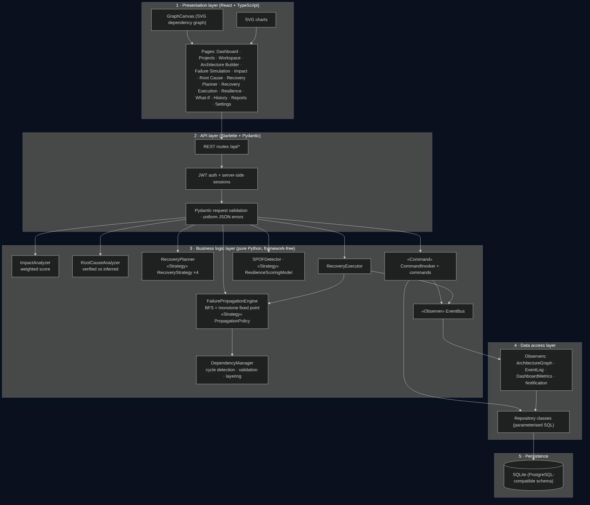
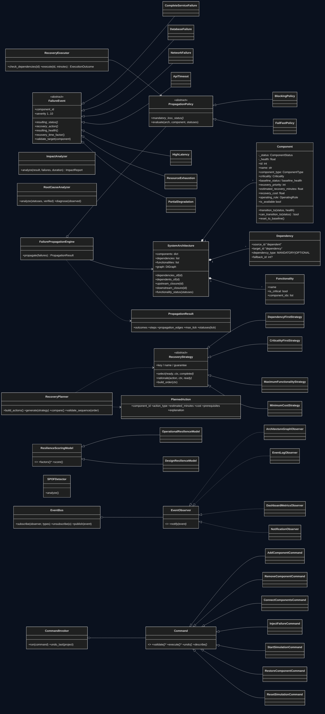
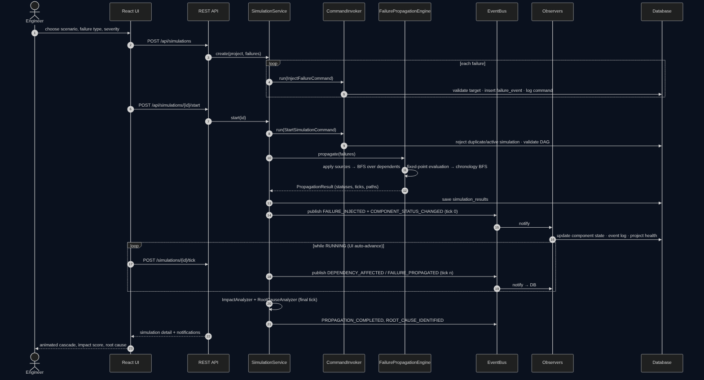

# System architecture



## Layers

| # | Layer | Location | Responsibility |
|---|---|---|---|
| 1 | Presentation | `frontend/src` | React pages, the SVG graph editor, charts, toasts and dialogs. Talks only to `/api`. No secrets in the client. |
| 2 | API | `backend/app/api` | Routing, JWT authentication against server-side sessions, Pydantic validation (`extra="forbid"`), ownership checks, one database transaction per request, uniform error JSON `{error:{code,message,details}}` |
| 3 | Business logic | `backend/app/domain`, `backend/app/engine`, `backend/app/services` | Pure domain model and engines (no HTTP, no SQL), plus services that orchestrate engines, commands and events |
| 4 | Data access | `backend/app/repositories.py`, observers in `services/context.py` | Every SQL statement, parameterised; mapping rows → domain aggregate (`load_architecture`) |
| 5 | Persistence | `backend/app/schema.sql` | Normalised relational schema (see [DATABASE.md](DATABASE.md)) |

The engines in `backend/app/engine` take a `SystemArchitecture` and return plain results, so they are unit-tested without a database or server (`tests/test_engine.py`).

## Business-logic components

| Component | Class(es) |
|---|---|
| Dependency Manager | `DependencyManager` |
| Simulation Engine | `SimulationService` (lifecycle, ticks) + `FailurePropagationEngine` |
| Failure Propagation Engine | `FailurePropagationEngine`, `PropagationPolicy` |
| Impact Analyzer | `ImpactAnalyzer` |
| Root Cause Analyzer | `RootCauseAnalyzer` |
| Recovery Recommendation Engine | `RecoveryPlanner`, `RecoveryStrategy` ×4 |
| Recovery Execution | `RecoveryExecutor`, `RecoveryService` |
| Resilience Scoring Engine | `SPOFDetector`, `ResilienceScoringModel` ×2 |

## Request lifecycle
1. The UI calls `POST /api/simulations/{id}/start` with `Authorization: Bearer <jwt>`.
2. `Api.route` validates the JSON body with Pydantic, opens a transaction, verifies the JWT signature, expiry and session row, and loads the user.
3. The handler resolves the simulation **owned by that user** (otherwise 404) and calls `SimulationService.start`.
4. The service runs `StartSimulationCommand` through the `CommandInvoker`, calls the propagation engine, stores results and publishes events. Observers update component state, the event log and dashboard metrics.
5. The transaction commits, and the response contains the simulation detail and notifications. Any exception rolls back.

## Simulation & recovery state machines

```
Simulation:  CREATED ─start→ RUNNING ⇄ PAUSED
                         │ (last tick)        └─stop→ STOPPED
                         ▼
                     PROPAGATED ─execute plan→ RECOVERING ─→ RECOVERED
                                                         └─→ PARTIALLY_RECOVERED ─(new plan)→ RECOVERING
             any active state ─reset→ RESET   (all components back to baseline)

Plan:        DRAFT ─execute→ EXECUTING ⇄ PAUSED ─→ COMPLETED | COMPLETED_WITH_FAILURES   (reset → SUPERSEDED)

Component:   HEALTHY → DEGRADED | BLOCKED | FAILED;  FAILED → RECOVERING;  RECOVERING → HEALTHY | DEGRADED | FAILED | BLOCKED
```

Only one simulation per project may be active. While one is active, architecture editing is locked (409 `SIMULATION_ACTIVE`). This keeps live component state consistent with the simulation that owns it.

## UML class diagram


## Sequence diagram: failure simulation


## Security & reliability
- Passwords: PBKDF2-HMAC-SHA256, 310 000 iterations, 16-byte random salt, constant-time comparison.
- Tokens: HS256 JWT containing a session id. Logout deletes the session, so the token is revoked immediately. Downloads use `fetch` with the header, so tokens never appear in URLs.
- Authorisation: every repository lookup for a project, component, dependency, simulation or plan joins on `projects.owner_id = current user`, and a mismatch is reported as 404.
- Input validation: strict Pydantic schemas (literals for enums, numeric bounds, unknown fields rejected), plus domain validation in commands.
- SQL injection: parameterised queries only.
- Transactions: one per request, with rollback on any error. `PRAGMA foreign_keys=ON` enforces referential integrity.
- Secrets and CORS: secrets come from environment variables or `.env`, and CORS uses an explicit origin allow-list.
- Isolation: simulations only modify rows in the application database. No shell, network or infrastructure calls exist.
