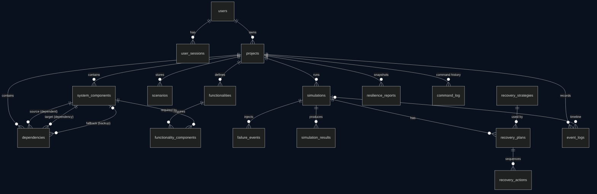

# Database design

The full DDL is in [`backend/app/schema_mysql.sql`](../backend/app/schema_mysql.sql) (MySQL 8, used on your laptop and in production) and [`backend/app/schema.sql`](../backend/app/schema.sql) (SQLite, used by the fast test-suite). Both define the same 17 tables and constraints. It is applied idempotently at startup (`CREATE TABLE IF NOT EXISTS`).

| Table | Purpose | Key constraints |
|---|---|---|
| `users` | accounts | `email` UNIQUE |
| `user_sessions` | server-side JWT sessions (logout = delete) | PK `jti`, FK user (cascade) |
| `projects` | one architecture per project | FK owner; UNIQUE(owner_id, name); CHECK policy ∈ {BLOCKING, FAIL_FAST} |
| `system_components` | components with live + baseline state and recovery configuration | FK project; UNIQUE(project_id, name); CHECK health 0–100, recovery time > 0, priority 1–5 |
| `dependencies` | directed edge source *depends on* target, optional backup | UNIQUE(source, target); CHECK source ≠ target; CHECK type ∈ {MANDATORY, OPTIONAL}; fallback FK ON DELETE SET NULL |
| `functionalities` | user-facing features (critical flag) | UNIQUE(project_id, name) |
| `functionality_components` | M:N functionality ↔ required component | composite PK |
| `scenarios` | saved and predefined failure scenarios (JSON list of failures) | UNIQUE(project_id, name) |
| `simulations` | simulation runs: status, tick, policy snapshot, stored impact and RCA JSON | FKs project and user; indexes (project_id, created_at), status |
| `failure_events` | injected failures (component name snapshotted) | CHECK severity 1–10 |
| `simulation_results` | per-component outcome: status, impact type, depth, tick, reason, causes, path | UNIQUE(simulation_id, component_id) |
| `recovery_strategies` | the four strategies (reference data) | UNIQUE key |
| `recovery_plans` | a plan per strategy and simulation: status, selection, validity, metrics, clock, summary | FKs simulation and strategy |
| `recovery_actions` | ordered actions with prerequisites, explanation, status, attempts, simulated times | index (plan_id, order_index) |
| `event_logs` | audit trail and timeline (category TIMELINE / ARCHITECTURE / …) | indexes (project_id, created_at), simulation_id |
| `resilience_reports` | score snapshots after propagation and recovery | index (project_id, created_at) |
| `command_log` | Command-pattern history with undo payloads | CHECK status ∈ {EXECUTED, UNDONE} |

**Normalisation.** Entities are in 3NF. JSON columns are used only for immutable *snapshots or derived documents*: stored impact/RCA reports, explanations, metrics, undo payloads and scenario definitions. These are never queried relationally. Component names are snapshotted in history tables, so history stays readable after components are deleted (their FKs become NULL).

**PostgreSQL mapping:**

| SQLite | PostgreSQL |
|---|---|
| `INTEGER PRIMARY KEY AUTOINCREMENT` | `BIGSERIAL PRIMARY KEY` |
| TEXT ISO timestamps | `TIMESTAMPTZ` |
| INTEGER booleans | `BOOLEAN` |
| TEXT JSON | `JSONB` |

All constraints, foreign keys and indexes are standard SQL.
